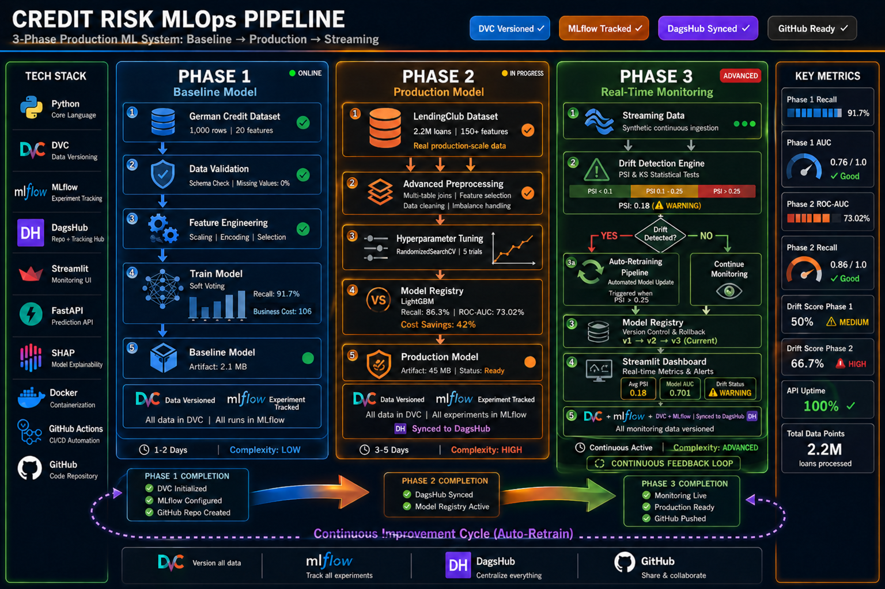

<div align="center">

# 🏦 Credit Risk MLOps Pipeline

### End-to-End Production ML System — Baseline → Production → Streaming

[](https://python.org)
[](https://dvc.org)
[](https://mlflow.org)
[](https://docker.com)
[](https://github.com/fcyber-labs/RiskOps/actions)
[](LICENSE)

[](https://github.com/fcyber-labs/RiskOps/actions/workflows/01-cicd.yml)

</div>

---

## 📋 Table of Contents

- [Project Overview](#-project-overview)
- [System Architecture](#️-system-architecture)
- [Phase 1 — Baseline (German Credit)](#-phase-1--baseline-german-credit)
- [Phase 2 — Production (LendingClub)](#-phase-2--production-lendingclub)
- [Phase 3 — Streaming & Monitoring](#-phase-3--streaming--monitoring)
- [Technical Stack](#-technical-stack)
- [Pipeline Features](#️-pipeline-features)
- [Performance Summary](#-performance-summary)
- [Project Structure](#-project-structure)
- [Quick Start](#-quick-start)
- [Experiment Tracking](#-experiment-tracking)
- [Key Learnings](#-key-learnings)
- [Roadmap](#️-roadmap)

---

## 🧠 Project Overview

> **A production-ready MLOps system for credit risk modeling** — engineered to evolve through three deployment phases, from fast prototyping to production-scale inference and monitoring.

This project is built around a **data-agnostic, modular pipeline** — plug in any tabular dataset and the system adapts. Rather than building isolated models, the emphasis is on **reproducibility, business impact, and continuous deployment** — the hallmarks of real MLOps engineering.

[](https://dagshub.com/fcyber/german-credit-mlops.mlflow/)
[](https://dagshub.com/fcyber/german-credit-mlops)
[](https://github.com/fcyber-labs/RiskOps)
[](https://hub.docker.com/r/fcyber/credit-risk-mlops)

### 🎯 Design Philosophy

| Principle | Implementation |
|-----------|---------------|
| **Business First** | Every model decision is evaluated in terms of financial cost, not just accuracy metrics |
| **Reproducibility** | DVC pipelines ensure any run can be reproduced exactly, anywhere |
| **Modularity** | Dataset adapters allow the same pipeline to process different data sources |
| **Transparency** | SHAP explainability at every stage — no black boxes in production |
| **Observability** | Drift detection + auto-retraining ensure the system stays relevant over time |

---

## 🏗️ System Architecture



---

## 🔵 Phase 1 — Baseline (German Credit)

> **Goal:** Validate the full end-to-end pipeline on a small, clean dataset. Ship fast. Learn fast.

### Dataset

| Attribute | Value |
|-----------|-------|
| Source | [UCI German Credit Dataset](https://archive.ics.uci.edu/dataset/144/statlog+german+credit+data) |
| Size | 1,000 rows |
| Features | 20 (mixed numerical + categorical) |
| Target | Binary — Good / Bad Credit Risk |
| Class Imbalance | ~70% Good / 30% Bad |

### Pipeline Steps

```
Step 1: DagsHub repo setup + MLflow connection
   ↓
Step 2: Raw data download → DVC tracking
   ↓
Step 3: EDA — distribution checks, imbalance analysis
   ↓
Step 4: Preprocessing — scaling, encoding, imputation, Yeo-Johnson
   ↓
Step 5: Feature engineering — interactions, K-Means clusters
   ↓
Step 6: Stratified train/test split + BorderlineSMOTE + TomekLinks
   ↓
Step 7: Optuna HPO (75 trials, 5-fold CV) + weighted probability blend
   ↓
Step 8: SHAP explainability + cost-sensitive threshold selection
   ↓
Step 9: DVC pipeline (dvc.yaml) — one command runs everything
```

### ✅ Results

| Metric | Value | Context |
|--------|-------|---------|
| **ROC-AUC** | **0.7598** | Discrimination |
| **Recall** | **91.7%** | 🎯 Primary objective — catch bad loans |
| **Precision** | **40.4%** | Accepted given the cost structure |
| **F2 Score** | **0.731** | Recall-weighted harmonic mean |
| **Business Cost** | **106** | Cost units from the cost matrix |

> 💡 **Key Insight:** High recall ensures almost all risky customers are identified — the critical metric in credit risk. Missing a bad loan (false negative) costs far more than flagging a good one.

---

## 🟠 Phase 2 — Production (LendingClub)

> **Goal:** Run the same pipeline architecture at production scale with richer features and an explicit business cost model.

### Dataset

| Attribute | Value |
|-----------|-------|
| Source | [LendingClub Loan Data](https://www.kaggle.com/datasets/wordsforthewise/lending-club) |
| Size | **2.2M+ loans** |
| Features | 150+ raw features |
| Target | Binary — Default / No Default |
| Adapter | `src/adapters/lendingclub_adapter.py` normalizes the schema |

### Business Cost Setup

| Error Type | Cost | Rationale |
|------------|------|-----------|
| **False Negative** (missed default) | **$13,500** | Full loan loss exposure |
| **False Positive** (denied good loan) | **$1,800** | Lost interest revenue |
| **Cost Ratio** | **7.5 : 1** | Drives recall-first optimization |

### Pipeline Enhancements

```
Phase 1 pipeline
   +
   ├── Dataset adapter layer (schema normalization)
   ├── Advanced feature engineering
   │     ├── Frequency encoding (high-cardinality categoricals)
   │     ├── Ordinal encoding (grade / sub_grade)
   │     ├── Feature interactions (rate × term, etc.)
   │     ├── Cluster-based features (borrower segmentation)
   │     └── Power transformations (skewed distributions)
   ├── Imbalance handling: BorderlineSMOTE + TomekLinks
   ├── Optuna HPO (trials set in params_lending.yaml)
   └── Cost-sensitive threshold calibration
```

### ✅ Results

| Metric | Value | Context |
|--------|-------|---------|
| **ROC-AUC** | **0.730** | At production scale |
| **Recall** | **86.3%** | Catches 86% of defaults |
| **Precision** | **27.2%** | Intentionally low — 7.5:1 cost ratio |
| **Lift @ Top 10%** | **2.43x** | vs. random targeting |
| **Cost Savings** | **42%** | vs. random-decision baseline |

> 💡 **Key Insight:** Precision is intentionally low. With a 7.5:1 cost ratio, catching more defaults at the price of more false alarms is the cheaper trade — this is financial engineering, not a weakness.

---

## 🟢 Phase 3 — Streaming & Monitoring

> **Goal:** Simulate a live system with continuous data, statistical drift detection, and automated retraining.

### Architecture

```
Synthetic Streaming Generator
          │
          ▼
  ┌───────────────┐      PSI < 0.10  →  ✅ STABLE — continue
  │Drift Detection│
  │  (PSI & KS)   │      PSI 0.10-0.25 → ⚠️ WARNING — monitor closely
  └───────┬───────┘
          │              PSI > 0.25  →  🔴 RETRAIN — trigger pipeline
          ▼
  ┌───────────────┐
  │ Decision Gate │
  └───────┬───────┘
          │
    ┌─────┴──────┐
    ▼            ▼
  Retrain    Continue
  Pipeline   Monitoring
    │            │
    └─────┬──────┘
          ▼
  ┌───────────────┐
  │ Model Registry│  ← Versioned models
  └───────┬───────┘
          ▼
  ┌───────────────┐
  │   Streamlit   │  ← Live dashboard: metrics, drift scores, alerts
  │   Dashboard   │
  └───────────────┘
```

### Drift Detection Logic

| PSI Range | Status | Action |
|-----------|--------|--------|
| `PSI < 0.10` | 🟢 **Stable** | Continue serving |
| `0.10 ≤ PSI < 0.25` | 🟡 **Warning** | Increase monitoring frequency |
| `PSI ≥ 0.25` | 🔴 **Critical** | Trigger retraining pipeline |

KS test is run on numerical features and a chi-square test on categorical features (`src/streaming/drift_detector.py`).

### Monitoring Dashboard *(illustrative layout, not live data)*

```
┌──────────────────────────────────────────────────┐
│           MONITORING DASHBOARD (sample)          │
│                                                  │
│  Avg PSI: 0.18  │  Model AUC: 0.701  │  ⚠️ WARN  │
│                                                  │
│  Feature Drift:                                  │
│  ████████░░ loan_amnt    PSI: 0.14  ⚠️           │
│  █████████░ int_rate     PSI: 0.11  ⚠️           │
│  ████░░░░░░ dti          PSI: 0.08  ✅           │
│  ██████████ annual_inc   PSI: 0.26  🔴 RETRAIN   │
└──────────────────────────────────────────────────┘
```

---

## 🧪 Technical Stack

<table>
<thead>
<tr>
<th>Category</th>
<th>Tools</th>
<th>Purpose</th>
</tr>
</thead>
<tbody>
<tr><td><b>Core Language</b></td><td>Python 3.10+</td><td>All pipeline stages</td></tr>
<tr><td><b>Data Processing</b></td><td>Pandas, NumPy, SciPy</td><td>EDA, feature engineering, transforms</td></tr>
<tr><td><b>ML Models</b></td><td>LightGBM, XGBoost, RandomForest, ExtraTrees</td><td>Weighted probability-blend ensemble</td></tr>
<tr><td><b>Hyperparameter Optimization</b></td><td>Optuna</td><td>Bayesian search</td></tr>
<tr><td><b>Imbalanced Data</b></td><td>BorderlineSMOTE + TomekLinks (imbalanced-learn)</td><td>Class rebalancing</td></tr>
<tr><td><b>Explainability</b></td><td>SHAP</td><td>Feature importance and force plots</td></tr>
<tr><td><b>Experiment Tracking</b></td><td>MLflow + DagsHub</td><td>Metrics, artifacts, registry</td></tr>
<tr><td><b>Data Versioning</b></td><td>DVC</td><td>Reproducible pipelines</td></tr>
<tr><td><b>Drift Detection</b></td><td>SciPy (KS), chi-square, custom PSI</td><td>Population Stability Index, KS test</td></tr>
<tr><td><b>API Serving</b></td><td>FastAPI, Uvicorn</td><td>Real-time and batch predictions</td></tr>
<tr><td><b>Monitoring UI</b></td><td>Streamlit</td><td>Drift and metrics dashboard</td></tr>
<tr><td><b>Containerization</b></td><td>Docker, Docker Compose</td><td>Multi-service orchestration</td></tr>
<tr><td><b>CI/CD</b></td><td>GitHub Actions, Ruff, pytest</td><td>Lint, tests, pipeline checks, Docker build, security scan</td></tr>
</tbody>
</table>

---

## ⚙️ Pipeline Features

### Data Processing
- Imputation, scaling, encoding, Yeo-Johnson power transforms
- Interaction features; K-Means cluster features (Phase 1)
- Ordinal and frequency encoding for LendingClub categoricals

### Model Training
- **Optuna HPO:** Bayesian search; 75 trials in Phase 1, count set in `params_lending.yaml` for Phase 2
- **Stratified K-Fold Cross-Validation**
- **Weighted probability blend:** LightGBM + XGBoost + RandomForest + ExtraTrees
- **Cost-sensitive threshold selection** from the business cost matrix
- **Early stopping** on gradient-boosted models

### Evaluation Suite
- **Ranking:** ROC-AUC, Gini coefficient, KS statistic
- **Classification:** precision, recall, F1, F2
- **Business:** cost, lift @ top 10%, savings vs. baseline
- **Calibration:** probability calibration checks

---

## 📊 Performance Summary

| Metric | Phase 1 | Phase 2 |
|---|---|---|
| Dataset size | 1,000 rows | 2.2M+ rows |
| ROC-AUC | 0.7598 | 0.730 |
| Recall | 91.7% | 86.3% |
| Precision | 40.4% | 27.2% |
| Lift @ top 10% | n/a | 2.43x |
| Cost savings | n/a | 42% |

### Key Achievements

- ✅ **Recall-first thresholds** derived from an explicit cost matrix
- ✅ **2.43x lift @ top 10%** in Phase 2
- ✅ **42% cost savings** vs. a random-decision baseline
- ✅ **Reproducible** — `dvc repro` rebuilds everything from versioned data and params
- ✅ **Modular** — dataset adapter lets the same pipeline process different sources

---

## 🚀 Quick Start

### 1. Clone

```bash
git clone https://github.com/fcyber-labs/RiskOps.git
cd RiskOps
```

### 2. Environment Variables

Create a `.env` file with your DagsHub credentials:

```bash
cat > .env << EOF
DAGSHUB_TOKEN=your_dagshub_token_here
MLFLOW_TRACKING_USERNAME=fcyber
MLFLOW_TRACKING_PASSWORD=your_dagshub_token_here
MLFLOW_TRACKING_URI=https://dagshub.com/fcyber/german-credit-mlops.mlflow
EOF
```

> Get your token: https://dagshub.com/user/settings/tokens *(needs read + write)*.

### 3. Run with Docker Compose

```bash
docker compose up
```

| Service | URL | Description |
|---|---|---|
| MLflow Tracking Server | http://localhost:5000 | Experiment tracking & model registry |
| Training Pipeline | — | Runs Phase 1 + Phase 2 |
| FastAPI Prediction API | http://localhost:8000 | Real-time credit risk predictions |
| Streamlit Dashboard | http://localhost:8501 | Monitoring dashboard |

### 4. Run Individual Phases (Alternative to Docker)

Install dependencies:

```bash
pip install -r requirements.txt
```

Configure MLflow:

```bash
export MLFLOW_TRACKING_URI="https://dagshub.com/fcyber/german-credit-mlops.mlflow"
export MLFLOW_TRACKING_USERNAME="fcyber"
export MLFLOW_TRACKING_PASSWORD="your_dagshub_token"
```

Phase 1 — Baseline:

```bash
cp params_german.yaml params.yaml
dvc repro
```

Phase 2 — LendingClub:

```bash
./run_full_lending_pipeline.sh
```

Phase 3 — API & Dashboard:

```bash
# Terminal 1: FastAPI
uvicorn src.api.app:app --host 0.0.0.0 --port 8000

# Terminal 2: Streamlit
streamlit run src/monitoring/dashboard.py --server.port 8501
```

### 5. Run Everything

```bash
./run_all.sh
```

Stop services with:

```bash
./stop_services.sh
```

---

## 📦 Project Structure

```text
RiskOps/
├── src_phase_1/        # Phase 1 code: preprocess, train, evaluate, explain (run by dvc.yaml)
├── src/
│   ├── adapters/       # LendingClub schema adapter
│   ├── features/       # LendingClub feature engineering
│   ├── api/            # FastAPI app and model registry
│   ├── streaming/      # data generators, drift detector, auto-retrain, live metrics
│   ├── monitoring/     # Streamlit dashboard
│   └── preprocess.py, train.py, evaluate.py, explain.py   # Phase 2 pipeline
├── config/             # logging config
├── tests/              # unit and integration tests
├── data/               # DVC-tracked raw data pointers
├── assets/             # architecture diagram
├── dvc.yaml            # Phase 1 pipeline (dvc_lending.yaml for Phase 2)
├── params*.yaml        # params.yaml is the active config; copy params_german/lending over it
├── docker-compose.yml  # mlflow, pipeline, api, dashboard
├── run_all.sh, run_full_lending_pipeline.sh, run_phase3.sh, stop_services.sh
└── .github/workflows/01-cicd.yml
```

| Service | Port | Description |
|---|---|---|
| MLflow | 5000 | Experiment tracking & model registry |
| FastAPI | 8000 | Real-time credit risk predictions |
| Streamlit | 8501 | Monitoring dashboard |

---

## 🔐 Environment Variables

| Variable | Purpose |
|---|---|
| `MLFLOW_TRACKING_URI` | MLflow server endpoint |
| `MLFLOW_TRACKING_USERNAME` | DagsHub username |
| `MLFLOW_TRACKING_PASSWORD` | DagsHub token |
| `DAGSHUB_TOKEN` | Used by DVC and Docker for the data remote |

---

## 💾 Data Management

Large datasets (200 MB+ LendingClub CSV) live in the DagsHub remote and are pulled by DVC at runtime:

- Docker image stays small
- Data pulled at runtime via DVC
- Volumes cache data between runs

---

## 📊 Experiment Tracking

Every pipeline run logs:

| Artifact | Description |
|----------|-------------|
| `hyperparameters` | Full search space + best trial params |
| `metrics` | ROC-AUC, recall, precision, F1/F2, business cost |
| `confusion_matrix.png` | Confusion matrix at the chosen threshold |
| `roc_curve.png` | ROC + precision-recall curves |
| `shap_summary.png` | Feature importance via SHAP |
| `shap_force.html` | Interactive individual explanations |
| `model.pkl` | Serialized ensemble model |
| `threshold.json` | Chosen threshold + cost breakdown |

👉 **View all runs:** [DagsHub MLflow Dashboard](https://dagshub.com/fcyber/german-credit-mlops.mlflow/)

---

## 🧩 Key Learnings

1. **Business metrics > model metrics** — A threshold set from a 7.5:1 cost ratio changed the model's behavior more than any hyperparameter search. Evaluate in money, not just AUC.

2. **Ensembles are worth it** — The weighted blend gave higher recall than any single model in the Phase 1 runs.

3. **Drift handling is part of the product** — A model without monitoring and a retraining path degrades silently. Here the mechanism is demonstrated on synthetic streams, not real traffic.

4. **Reproducibility is infrastructure** — DVC plus params files removed most "works on my machine" problems. Switching phases by copying a params file is simple but easy to forget.

5. **Restructuring needs CI discipline** — Moving code between folder layouts breaks paths in CI, Docker and docs, so those need to be updated in the same change.

---

## ⚠️ Known Limitations

- **Phase 3 uses synthetic data only.** No live data source, so drift behavior shows the mechanism works, not production behavior.
- **Phase 2 Optuna trials.** `params_lending.yaml` sets `n_trials: 15` — increase for a full tuning run. Reported Phase 2 metrics come from that 15-trial run.
- **Two code trees.** `src_phase_1/` vs. `src/` overlap; merging is planned.
- **Config switching is manual.** `params.yaml` is overwritten by copying `params_german.yaml` or `params_lending.yaml`.
- **CI paths.** Workflow still references `./01-credit-risk-mlops` from an earlier layout — needs to be pointed at the repo root.

---

## 🗺️ Roadmap

| Feature | Status | Stage |
|---------|--------|-------|
| German Credit baseline pipeline | ✅ Complete | Phase 1 |
| DVC + MLflow integration | ✅ Complete | Phase 1 |
| LendingClub production pipeline | ✅ Complete | Phase 2 |
| Cost-sensitive optimization | ✅ Complete | Phase 2 |
| Synthetic streaming generator | ✅ Complete | Phase 3 |
| PSI / KS / chi-square drift detection | ✅ Complete | Phase 3 |
| Auto-retraining pipeline | ✅ Complete | Phase 3 |
| Streamlit monitoring dashboard | ✅ Complete | Phase 3 |
| FastAPI prediction endpoint | ✅ Complete | Phase 3 |
| Docker containerization | ✅ Complete | Delivery |
| CI/CD with GitHub Actions | ✅ Complete | Delivery |
| Real data source for monitoring | 🔲 Planned | — |

---

## 📄 License

This project is licensed under the **MIT License** — see [LICENSE](LICENSE).

---

<div align="center">

**Built as a complete MLOps Project**

[](https://github.com/fcyber-labs/RiskOps)
[](https://dagshub.com/fcyber/german-credit-mlops.mlflow/)
[](https://dagshub.com/fcyber/german-credit-mlops)

<br/>


</div>